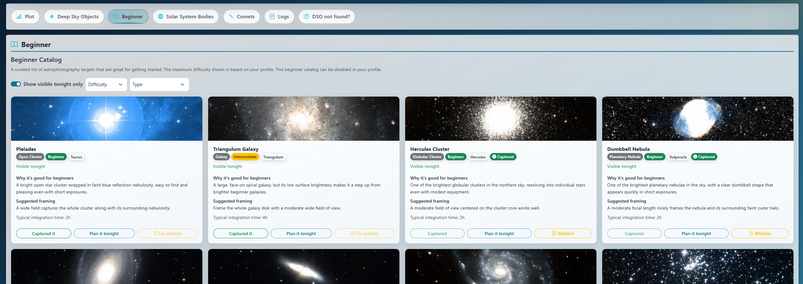
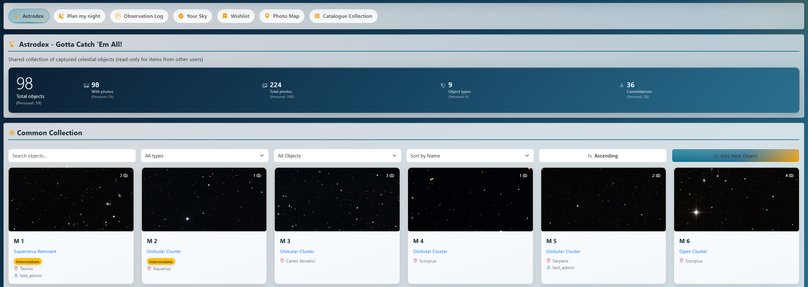
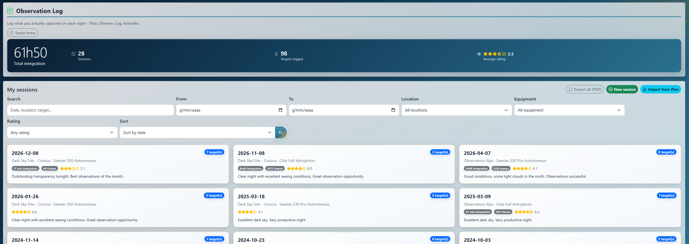
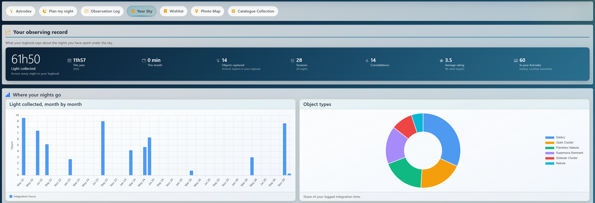
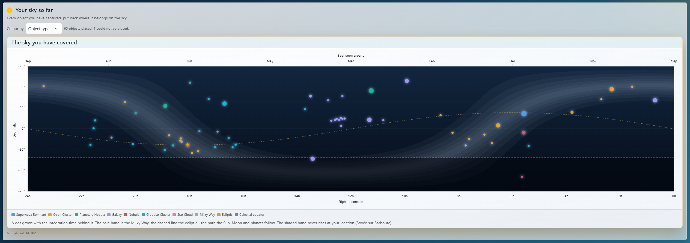

# MyAstroBoard - Visual Tour

A walkthrough of MyAstroBoard's interface, tab by tab - from tonight's go/no-go decision to the
logbook of everything you have imaged. Each section links to the page that documents the feature
in full.

## Table of Contents

1. [Astrophotography](#astrophotography)
2. [Weather](#weather)
3. [SkyTonight](#skytonight)
4. [Astrodex](#astrodex)
5. [Spaceflight](#spaceflight)
6. [Observatory](#observatory)
7. [Equipment](#equipment)
8. [My settings](#my-settings)
9. [App settings](#app-settings)
10. [Everywhere](#everywhere)

---

## Astrophotography

Everything you need to decide whether tonight is worth setting up the telescope.
Details: [ASTROPHOTOGRAPHY.md](ASTROPHOTOGRAPHY.md).

### Astrophotography

The night's conditions through an astrophotographer's eyes - clouds, transparency, seeing, wind,
humidity, dew risk - with alerts when something will spoil the session.

### Best window

The best imaging window of the night, computed in three modes: Moon below the
horizon, Moon below 5 degrees, or Moon less than 15% lit.

### Moon

Phase, rise and set, altitude chart, dark-sky window, the next nights and a monthly phase calendar.
Lunar eclipses are highlighted.

### Sun

Twilight times, altitude chart and the next solar eclipse for your location.

### Aurora Borealis

Kp forecast and a visibility assessment for your latitude.

### Events Calendar

Upcoming sky events - conjunctions, oppositions, meteor showers, eclipses, ISS transits - with the
parameters that help you prioritize them. An event can be turned into a share card.

---

## Weather

Details: [WEATHER.md](WEATHER.md).

### Weather

Hourly forecast for the night from Open-Meteo: temperature, precipitation, cloud layers, wind,
pressure.

### Seeing Forecast

Seeing and transparency from 7Timer for your location.

### Observation Conditions

Time series of the atmospheric conditions to find the sweet spot of the night.

---

## SkyTonight

SkyTonight computes the best targets for the coming night from a dozen catalogues and ranks them
with an **AstroScore** (visibility, sky quality, brightness, comfort). Details:
[SKYTONIGHT.md](SKYTONIGHT.md).

### Plot

A polar map of the sky with the path of every observable target tonight; click a target to
inspect it.

### Deep Sky Objects

Thousands of deep-sky objects, scored and sorted. Filter by type, size, magnitude, constellation,
AstroScore, or by how well a target fits your equipment. "Tonight for you" picks a few targets
matched to your experience level ([BEGINNER_EXPERIENCE.md](BEGINNER_EXPERIENCE.md)).

Each target opens a details panel with catalogue names, transit time, a visibility calendar over
the year, and the equipment combinations that suit it best.

The Beginner catalogue is a curated list of forgiving targets, each with an explanation.

### Solar System Bodies and Comets

The Moon and planets, and the comets currently observable, from live orbital elements.

### Altitude charts

An altitude-vs-time chart for every target, with the astronomical night and the observable zone,
and your horizon profile.

### Framing simulator

Your sensor's field drawn over a real image of the sky around a target, with rotation and up to
three equipment combinations compared side by side. Also opens from the Wishlist, Plan My Night
and the Astrodex. See [SKYTONIGHT.md](SKYTONIGHT.md#framing-simulator).

---

## Astrodex

Your logbook, from the plan to the finished picture: Plan -> Observe -> Log -> Astrodex.

### Astrodex

Your collection of imaged objects, with your pictures, their acquisition details, ratings and
notes. A picture can be turned into a share card, or sent to MyAstroShine for re-processing
([MYASTROSHINE.md](MYASTROSHINE.md)). Details: [ASTRODEX.md](ASTRODEX.md).

### Plan my night

Turn your SkyTonight shortlist into a timeline for the night: durations, ordering (by hand or by
the optimizer), live progress during the night, CSV and PDF export. Shared equipment combinations
appear in the combination selector alongside your own. Details: [PLAN_MY_NIGHT.md](PLAN_MY_NIGHT.md).

### Observation Log

One record per night: conditions, equipment, and what you shot on each target. A plan becomes a
session in one click, and frames logged on a target add it to the Astrodex. Details:
[OBSERVATION_LOG.md](OBSERVATION_LOG.md).

### Your Sky

Everything the Observation Log knows, read back to you: total integration time, the object types
and constellations you favour, which equipment did the work, and how your ratings line up with the
seeing, transparency, SQM and Moon you recorded. Every comparison shows its own sample count, and a
group with too few nights behind it says so. Details: [SESSION_ANALYTICS.md](SESSION_ANALYTICS.md).

The sky coverage chart draws your captures over the Milky Way and the ecliptic, with the band of
sky that never rises from your location shaded out.

### Wishlist

The targets you want to image next, with a priority, when each one is next visible, and how many
you have already captured.

### Photo Map

Where your pictures were taken, on a map, from the locations you entered on them. Whether other
users' pictures appear is an administrator setting.

### Catalogue Collection

Pick a catalogue (Messier, Caldwell, Herschel 400...) and see which of its objects you have
already caught.

---

## Spaceflight

Details: [SPACEFLIGHT.md](SPACEFLIGHT.md).

### Launches

Upcoming and recent launches, with a detailed view and the webcast when one is available.

### Astronauts

Who is in space right now, on which vehicle, and for how long.

### Space Events

Mission milestones, spacewalks, dockings and other spaceflight events.

### Orbital Stations

Visible passes of the ISS and the China Space Station (Tiangong) over your location, and their
transits across the Sun and the Moon.

---

## Observatory

A live panel fed by your own equipment through connectors: AllSky camera image, keogram, startrails,
timelapse and sensor data. The tab appears once a connector is enabled. Details:
[OBSERVATORY.md](OBSERVATORY.md), [CONNECTORS.md](CONNECTORS.md).

---

## Equipment

Telescopes, cameras, mounts, filters and accessories, combined into named equipment combinations.
Combinations feed the target recommendations, the field-of-view filters, the framing simulator and
the exposure calculator. Details: [EQUIPMENT.md](EQUIPMENT.md), [EXPOSURE_CALC.md](EXPOSURE_CALC.md).

### Sharing equipment

Every piece of equipment can be marked **Share with all users**. Shared items show up, read-only,
for every other user: in their Equipment tab, the FOV calculator, the target recommendations, the
Astrodex picture form and the Plan My Night combination selector. A combination counts as shared
only when every piece it uses is shared. When a shared combination goes away, plans built on it
are kept and show a warning. Useful for a family or a club that shares a mount or a filter set.

---

## My settings

Each user's own preferences: theme (including a red night-vision theme), startup tab, density,
time format, experience level, their locations, notifications, password and two-factor
authentication, and the download of their personal data. Details: [USER_SETTINGS.md](USER_SETTINGS.md).

---

## App settings

Administration of the instance (admin only). Details: [CONFIGURATION.md](CONFIGURATION.md).

- **Locations**: up to five location presets, attributed to users ([LOCATIONS.md](LOCATIONS.md)).
- **Configuration**: SkyTonight constraints, Astrodex privacy, notifications contact, reverse proxy,
  MQTT connections.

- **Connectors**: AllSky, MyAstroShine, MQTT / Home Assistant, Astrodex Stream
  ([CONNECTORS.md](CONNECTORS.md), [HOME_ASSISTANT.md](HOME_ASSISTANT.md)).
- **Logs**: live log viewer, levels, retention, and an export to attach to a GitHub issue.

- **Users**: accounts and roles (admin, user, read-only), trusted networks, two-factor policy
  ([AUTHENTICATION.md](AUTHENTICATION.md)).

- **Metrics**: system, database, scheduler and cache job health.

- **Backup / Restore**: one archive with your configuration, accounts and collections.

---

## Everywhere

- **Sky status widget** in the header: the current state of the night and the active location,
  with a switcher when you have several.
- **Share cards**: a picture, a session, tonight's sky or an event as a ready-to-post image
  ([SHARE_CARDS.md](SHARE_CARDS.md)).
- **Phones**: installable as an app, with push notifications ([MOBILE.md](MOBILE.md)).
- **Six languages**: English, French, Spanish, German, Italian, Portuguese.
